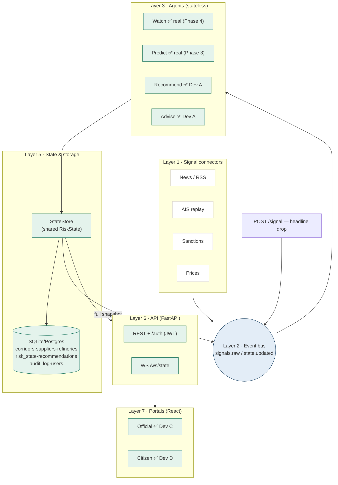

# URJA KAVACH — Project Guide, Architecture & Handoff

**AI-Driven Energy Supply Chain Resilience for India · ET AI Hackathon 2026**

> This is the master **architecture + PRD + historical record** for the whole
> project: the workflow, the full PRD (v1.0 baseline plus the v1.3 delta), and a
> status board of what each original developer (Dev A / B / C / D) built for the
> v1.0 milestone. **For what to build next, see [PLAN.md](.claude/docs/PLAN.md)** — the PRD
> moved to v1.3 after the v1.0 milestone below shipped, and the remaining work is
> tracked there as phased vertical slices (Segment 1: AI + Backend; Segment 2:
> Frontend + Integration), not as a per-developer split. A new teammate or AI
> agent should read PLAN.md first for *what's next*, and come here for *why the
> system is shaped this way* and *what already exists*.

---

## How to use this file (handoff protocol)

When someone is asked to work on a **specific part** — "continue Dev A", "do the
Dev B agents", "build the Dev C official portal" — they should:

1. Read **[PLAN.md](.claude/docs/PLAN.md)** to find the current phase and what it depends on —
   that file is the live task list, phased as vertical slices rather than by
   person.
2. Come back here for the **[Status board](#status-board)** (what already
   shipped for v1.0) and the relevant historical dev section for context on how
   the piece you're extending was originally built:
   [Dev A](#dev-a--backend--integration-done) ·
   [Dev B](#dev-b--aiml-partially-done) ·
   [Dev C](#dev-c--official-portal-done) ·
   [Dev D](#dev-d--public-portal-done--landing).
3. Honour the **frozen contract** (`backend/schemas/contract.py`) — never edit it
   without the contract-change protocol. Import models from `backend.schemas`.
4. Build against the running API (see [Run it](#run-it)); the endpoints already
   return real, contract-valid state.
5. When done, **update PLAN.md's phase table and the status board in this file**
   so the next person sees accurate state in both places.

**Golden rule:** the contract is law. If your code disagrees with
`backend/schemas/contract.py`, your code is wrong (or the contract needs a
versioned change — see the [contract-change protocol](#integration-playbook)).

---

## Status board

Legend: ✅ done · 🟡 partial · ⬜ not started

**This board is the historical record of the PRD v1.0 milestone** (already
shipped, per-developer). It is frozen as a record of what exists and who built
it — it does **not** track the v1.3 gap. For the live, forward-looking task
list (phased vertical slices, not per-person), see **[PLAN.md](.claude/docs/PLAN.md)**.

| Dev | Area | Status | Summary |
|---|---|---|---|
| **Dev A** | Backend, DB, event bus, Recommend + Advise, API, auth, `/audit`, deploy | ✅ **DONE — tested & bug-checked** | Full API + cascade running; **91 tests** passing; verified on localhost; 2 security issues found & fixed |
| **Dev B** | Contract schema (Deliverable 0) | ✅ done | Frozen Pydantic contract + 43 tests |
| **Dev B** | Watch + Predict (real LLM/RAG), knowledge graph, provenance | 🟡 partial | Predict is now real (PLAN.md Phase 3, see SPEC.md); Watch is still **stubbed** so the cascade runs — real LLM logic is [PLAN.md](.claude/docs/PLAN.md) Segment 1, Phase 4 |
| **Dev C** | Official portal (Next.js) | ✅ **DONE — built & verified** | Mission Control (one-button cascade), gauge+provenance, interactive map (zoom/fullscreen/satellite), what-if simulator, reroutes+approve, SPR tank, audit trail |
| **Dev D** | Public portal (Next.js) + landing | ✅ **DONE — built & verified** | Premium marketing landing, citizen status board, conservation cards, live action feed. Deck + demo video still to record |

> **Sign-off:** backend + both portals are feature-complete for the **v1.0**
> demo. All **91 tests pass** (43 Dev B contract + 48 Dev A, incl. `/audit`). The
> frontend is **Next.js 16 + React 19 + Tailwind v4 + shadcn/ui**, Apple-style,
> blue-based, full light + dark. Verified end-to-end on localhost (backend
> `uvicorn` + `next dev`) and with `next build`. The `swosti_kavach` → `main`
> merge referenced by older docs/commits is complete — `main` is the single
> integrated branch. Remaining before deploy: set a real `JWT_SECRET`. See
> [Security notes](#security-notes). **The PRD has since moved to v1.3** — see
> [PLAN.md](.claude/docs/PLAN.md) for the ten new features (F11, F13–F20) this board doesn't
> cover.

### What's next
The v1.0 milestone above is done. All new work — the v1.3 features (geospatial/
AIS layer, backtest, power stress, wrong-oil gate + real route cost, dark-ship
ML, alarm-language score, assumption sourcing) — is tracked in **[PLAN.md](.claude/docs/PLAN.md)**
as Segment 1 (AI + Backend, Phases 1–10) and Segment 2 (Frontend + Integration,
Chunks A–I), not in this per-dev board.

> **Segment 1, Phases 1–3 have landed** (see [SPEC.md](SPEC.md)): the contract
> and DB are at the **v1.3 shape** — `Impact.power_stress_pct`, typed/sourced
> `Assumptions`, `assumption_overrides`, `Reroute.refinery_id`/`grade_ok`/
> `rank_eligible`/`reason`/`cost_breakdown`/`true_cost`, and new `geo`/
> `validation` blocks all exist and validate (Phase 1); Recommend's wrong-oil
> hard gate and real `true_cost` (crude + war-risk insurance + detour) ranking
> are real, not placeholders (Phase 2); Predict is now the real, sourced v1.3
> domino model — `power_stress_pct` is genuinely computed (no longer `0.0`),
> `gdp_delta_pct` uses the corrected `gdp_oil_sensitivity` coefficient instead
> of the old hardcoded `0.066`, and assumption-slider overrides are logged to
> `audit_log` immediately and snapshotted onto `RiskState.assumption_overrides`
> at Approve time via the new `POST /assumptions/override` endpoint (Phase 3).
> `geo` and `validation` still stay `None` — SPEC.md documents exactly which
> fields are real vs. placeholder per phase.
>
> **Segment 1, Phase 4 has landed too** (see [SPEC.md](SPEC.md)): Watch is
> no longer a stub-only agent — `backend/agents/watch.py`'s `run_watch()`
> retrieves grounded, cited snippets from a curated RAG corpus (ChromaDB,
> local embeddings) and scores the corridor via a real LLM call (Groq),
> falling back to the deterministic keyword-bump stub on any of: the
> `USE_REAL_AGENTS` flag being off (the default), a missing `GROQ_API_KEY`,
> an unrecognized corridor, an empty retrieval, or an LLM failure on both of
> its two model tiers. `confidence`/`band` are derived from retrieval
> agreement, never the LLM's self-report. **223 backend tests pass** (up
> from 188).
>
> **Segment 1, Phase 5 has landed too** (see [SPEC.md](SPEC.md)):
> `backend/agents/graph.py` models the supplier→corridor→refinery network
> (NetworkX) and answers "if hormuz closes, what's affected?" via
> `affected_by()` — verified against today's seed data (e.g. closing
> `suez_cape` correctly excludes `paradip`, which isn't grade-compatible
> with either of that corridor's suppliers). Deliberately **not** wired into
> `RiskState`/`cascade.py`/the API this phase — `geo` stays `None` until
> PLAN.md Phase 6 populates the whole block and calls `affected_by()` for
> `affected_refinery_ids`. **232 backend tests pass** (up from 223).
>
> **Segment 1, Phase 6 has landed too** (see [SPEC.md](SPEC.md)): the
> geospatial data layer is real — a curated, deterministic 16-tanker AIS
> replay set (`backend/agents/data/ais_sample.json`) and hand-authored
> corridor GeoJSON polylines (`backend/seed/geo/*.geojson`), wired together
> by the new `backend/agents/geo.py`'s `build_geo()`. `cascade.py` gained a
> fifth step that calls it, so **`RiskState.geo` is genuinely populated for
> the first time** (`None` on a fresh boot, populated after the first
> `POST /signal` — same pattern as `impact`/`reserve`). The new
> `GET /geo/state` bundles the live `geo` block with corridor/refinery
> config and the raw tanker tracks for Segment 2's map. **252 backend tests
> pass** (up from 232).
>
> **Segment 1, Phase 7 has landed too** (see [SPEC.md](SPEC.md)): the
> dark-ship anomaly detector — the project's one real, learned-from-data
> component. `backend/agents/anomaly.py` fits a fixed-`random_state`
> `sklearn.ensemble.IsolationForest` over four per-vessel features derived
> from Phase 6's AIS replay set (transponder-gap hours, heading-change
> degrees, speed variability, and deviation from the tanker's own initial
> course). The interview's literal pick — distance to the shared corridor
> polyline via `shapely` — was tested with real numbers and rejected: each
> clean tanker is deliberately seeded in its own parallel "lane" offset from
> that polyline, which swamped the actual anomaly signal, so `shapely` was
> never added. Three of Hormuz's four curated tankers (`hormuz_02/03/04`)
> are now a synthetic "went dark" case; `geo.dark_tanker_ids` is genuinely
> populated for the first time (filtered by the signal's elevated
> corridors, mirroring `at_risk_tanker_ids`), and the corridor-scoped
> dark-tanker count reaches both Watch's real LLM prompt (as one more
> grounded context line, never blended into the score arithmetically) and
> its offline stub fallback (a `+10.0`-per-tanker bump, since the detector
> has no network dependency and is available even when `USE_REAL_AGENTS` is
> off). The AIS data source itself is now configurable
> (`Settings.ais_data_path` / `AIS_DATA_PATH`, defaulting to the committed
> replay set) — the one seam a live feed would plug into without touching
> `geo.py`/`anomaly.py`. **273 backend tests pass** (up from 252).
>
> **Segment 1, Phase 8 has landed too** (see [SPEC.md](SPEC.md)): the
> backtest/validation module. `backend/agents/backtest.py` replays one
> curated historical case — the Red Sea/Houthi shipping crisis, Nov 2023 –
> Mar 2024, scored on `suez_cape` — through the real `run_watch`
> chronologically, overlays the score timeline against a hand-curated,
> explicitly-labeled-illustrative Brent price series, and computes
> `signal_lead_hours`. `retrieve()`/`run_watch()` gained a genuine `as_of`
> cutoff (defaulting to `None` everywhere in the live cascade) so a corpus
> snippet dated after the headline being scored can never leak in — the
> future-info-leak risk PLAN.md's own Phase 4 note had flagged but left
> unresolved. `GET /backtest/{id}` is a fully standalone, side-effect-free
> read — it never writes to `RiskState.validation` or triggers a WS push,
> unlike every cascade-adjacent endpoint elsewhere in the API; `validation`
> therefore stays permanently `None` on `RiskState` in this codebase. The
> hand-verified worked example (deterministic stub-fallback path, no API key
> needed): `signal_lead_hours == 1464.0` (~61 days) — the real-LLM-path
> number still needs verification against a live `GROQ_API_KEY`. **293
> backend tests pass** (up from 273).
>
> **Segment 1, Phase 9 has landed too** (see [SPEC.md](SPEC.md)): the two
> cheapest, lowest-priority v1.3 additions. `backend/agents/alarm.py` is a
> TF-IDF + logistic-regression classifier over a small, hand-curated,
> committed corpus of **general** alarming-vs-calm language (67 rows) — the
> interview's first draft (disaster/emergency vocabulary only) was tested
> and found to barely discriminate on real oil-corridor headlines (every one
> scored within a few points of the 0.5 boundary); the committed corpus adds
> a generic conflict/security vocabulary sub-group so it can actually tell
> alarming from calm on the domain it's applied to, without training on
> oil-crisis outcomes. Its binary verdict reaches Watch's real prompt as one
> more context line (mirroring Phase 7's dark-ship line, never blended into
> the score) and the offline stub as a matching `+8.0` bump — unlike the
> dark-ship line, it is **not** suppressed under `as_of` (tone has no
> present-day-snapshot dependency to make stale). Separately,
> `GET /public/status` now calls `backend/agents/conservation.py`'s
> `generate_conservation_copy()` for LLM-generated, scenario-specific
> `message`/`conservation_plan` content (cached by `level|corridor_name`,
> single model tier, static fallback with no API key or at `status ==
> "Normal"`) — `status` itself stays a rule-based severity threshold, never
> LLM-decided. No contract change either slice. **319 backend tests pass**
> (up from 293).
>
> **Segment 1, Phase 10 is partially landed, blocked on a live
> `GROQ_API_KEY`** (see PLAN.md's Phase 10 section for the full breakdown):
> the curated demo dataset (#1) and full regression (#4/#5) are already
> true by construction of Phases 6–9; the RAG store's local-embedding half
> of #2 is verified working with zero API keys (a real Hormuz-query smoke
> test retrieved the 5 correct snippets against a fresh scratch vector
> store); but committing real `.llm_cache/` entries (the other half of #2)
> and #3's browser-verified `USE_REAL_AGENTS=1` demo run both need a live
> key this environment doesn't have. All agent/data-layer code is done —
> what's left of Segment 1 is a live-key-and-a-browser cutover step, not
> more code.

### End-to-end status
The full stack runs locally today: `uvicorn backend.app:app` (:8000) + `cd frontend && npm run dev` (Next.js, :3000), open `http://localhost:3000`. Flow: **premium landing → register/login (role dropdown) → officials land on Mission Control → "Launch Simulation" injects a headline → the cascade animates through the cockpit; citizens see the calm status board**. Verified through the Next.js proxy: register/login (both roles), inject→cascade, reroutes+sort, simulate, approve (official-only), audit trail (official-only), public status, WS push, and `proxy.ts` role redirects. Backend: **319 tests pass** (see [PLAN.md](.claude/docs/PLAN.md) for the per-phase breakdown). Frontend: `next build` clean; light + dark verified by screenshot.

> All frontend work, the `/audit` endpoint, and the `swosti_kavach` → `main`
> merge are committed — `main` is up to date with the work described above.

---

## Architecture workflow

Layered, event-driven. A signal enters, lands on the event bus, is processed by
stateless agents that read/write one shared state object, and is served to two
portals through one API. Every layer is swappable.



### The cascade (demo money-shot)

```
POST /signal {corridor, headline, severity}
      │
      ▼
[Watch]  score corridor → merge_watch()  → derive severity → publish state.updated
      │
      ▼
[Predict] glass-box impact from assumptions → merge_predict() → publish
      │
      ▼
[Recommend] rank supplier+route options (exclude disrupted corridor) → merge_reroutes() → publish
      │
      ▼
[Advise] reserve depletion sim → merge_reserve() → publish
      │
      ▼
Every publish pushes a FULL RiskState snapshot over /ws/state → both portals animate live.
```

Predict is now the real v1.3 model (`backend/agents/predict.py`, PLAN.md
Phase 3 — see SPEC.md), and Watch is now the real RAG+LLM agent too
(`backend/agents/watch.py`, PLAN.md Phase 4 — see SPEC.md), with the
deterministic stub (`backend/agents/stubs.py`) still importable as its
internal offline fallback. Every agent in the cascade is real now — nothing
else in the pipeline changed when either one graduated, which is the whole
point of building against the contract.

---

## Repository layout

```
Urja-Kawach/
├── PROJECT_GUIDE.md              ← this file (architecture + PRD + handoff)
├── README.md                     ← Dev B: the frozen contract layer (Deliverable 0)
├── README-dev-a.md               ← Dev A: backend run guide
├── backend/
│   ├── schemas/contract.py       ✅ Dev B — FROZEN contract (do not edit)
│   ├── config.py db.py models.py ✅ Dev A — settings, SQLAlchemy, 6+1 tables
│   ├── seed.py  seed/*.json       ✅ Dev A — config seeding (new corridor = one row)
│   ├── bus.py                    ✅ Dev A — in-memory event bus (Redis-ready)
│   ├── state_store.py cascade.py ✅ Dev A — merge/validate/publish + orchestration
│   ├── agents/
│   │   ├── recommend.py advise.py ✅ Dev A — real scoring agents
│   │   ├── watch.py               ✅ Dev B — real RAG+LLM agent (Phase 4, Groq + ChromaDB)
│   │   ├── graph.py               ✅ Dev B — knowledge graph, affected_by() (Phase 5, F10)
│   │   ├── ais.py geo.py          ✅ Dev B — AIS replay loading + Geo block, build_geo() (Phase 6, F11/F13)
│   │   ├── anomaly.py             ✅ Dev B — IsolationForest dark-ship detector (Phase 7, F18)
│   │   ├── backtest.py            ✅ Dev B — historical replay + lead-time (Phase 8, F14)
│   │   ├── alarm.py               ✅ Dev B — TF-IDF+LogReg alarm-language classifier (Phase 9, F19)
│   │   ├── conservation.py        ✅ Dev B — LLM conservation copy for /public/status (Phase 9, F7 slice)
│   │   └── stubs.py              ✅ Watch's offline fallback (deterministic, no LLM + dark-ship + alarm bump)
│   ├── api/routes.py app.py      ✅ Dev A — REST + WS + app factory
│   ├── auth/  middleware/         ✅ Dev A — JWT register/login + role guards
│   └── ...
├── India Connect Portal/          ✅ the frontend — Vite + TanStack Start · React 19 · Tailwind v4 · shadcn/ui
│   ├── src/routes/index.tsx      ✅ premium marketing landing
│   ├── src/routes/mission.tsx    ✅ Mission Control + one-button "Launch Simulation" cascade
│   ├── src/routes/official.tsx   ✅ orchestration cockpit
│   ├── src/routes/public.tsx     ✅ citizen status board
│   ├── src/routes/auth.tsx       ✅ login/register + role toggle → dashboard
│   ├── src/components/kavach/RequireRole.tsx ✅ client-side role gating (no middleware in this stack)
│   ├── vite.config.ts            ✅ dev proxy /api/* → backend (no CORS); WS connects direct
│   ├── src/hooks/useRiskState.ts ✅ WS-backed shared state (the cascade hook)
│   ├── src/components/kavach/*   ✅ map, header, gauge and other domain components
│   ├── src/components/ui/        ✅ shadcn/ui primitives
│   └── src/lib/                  ✅ api client, session, auth, utils
│   (see India Connect Portal/spec.md for the full phased build history)
└── tests/                        ✅ 323 tests (contract + backend/auth/audit/watch/rag/llm/graph/geo/anomaly/ais/backtest/alarm/conservation)
```

---

## Run it

```bash
# 1) backend  (http://localhost:8000/docs)
python -m venv .venv && . .venv/bin/activate      # Windows: .venv\Scripts\activate
pip install -r requirements.txt
uvicorn backend.app:app --reload
python -m pytest                                  # 319 tests

# 2) frontend (http://localhost:8080)  — in a second terminal
cd "India Connect Portal" && npm install && npm run dev
```

Startup creates tables and seeds `backend/seed/*.json`. Open
`http://localhost:3000`, register as Citizen or Official, and you land on the
matching portal. Backend-only full stack: `docker compose up`.

---

# Developer sections

## Dev A — Backend & integration (DONE)

**Owns:** API gateway, event bus, DB + config seeding, **Recommend** + **Advise**
agents, audit log, deployment, and is the **integration owner** (contract guardian).

**Built:**
- **DB** (`backend/models.py`): the 6 PRD tables (corridors, suppliers,
  refineries, risk_state, recommendations, audit_log) + a `users` table for auth.
  All numeric columns are `Float` (never `INTEGER`) per contract rule #2.
- **Config seeding** (`backend/seed.py`, `seed/*.json`): idempotent upsert on
  startup — a new corridor/supplier/refinery is one JSON row.
- **Event bus** (`backend/bus.py`): in-memory pub/sub behind an `EventBus`
  interface; Redis Streams can drop in later unchanged.
- **State store** (`backend/state_store.py`): merges each validated agent block,
  **re-validates the whole `RiskState`** (drift alarm), stamps tz-aware UTC
  `updated_at`, persists, publishes a **full snapshot** on `state.updated`.
- **Cascade** (`backend/cascade.py`): signal → Watch → Predict → Recommend → Advise.
- **Recommend** (`backend/agents/recommend.py`): min-max scoring with
  price/speed/compat **component scores returned alongside the total** (never a
  bare number); cost/speed weight presets.
- **Advise** (`backend/agents/advise.py`): glass-box reserve depletion sim.
- **API** (`backend/api/routes.py`, `app.py`): all PRD §8 endpoints + WS.
- **Auth** (`backend/auth/`, `backend/middleware/`): JWT register/login with
  `citizen` | `official` roles; `/approve` is official-only.

**Endpoints:**

| Method | Path | Purpose |
|---|---|---|
| GET | `/health` | Liveness |
| GET | `/state` | Current `RiskState` |
| POST | `/signal` | Inject signal → cascade |
| POST | `/simulate` | What-if: strict `Assumptions` → `Impact` (pure) |
| POST | `/assumptions/override` | **Auth required** — log a slider commit that diverges from default → `audit_log` (F20, [v1.3] PLAN.md Phase 3) |
| GET | `/reroutes?sort=cost\|speed\|balanced` | Ranked options + score breakdown |
| GET | `/geo/state` | Live `geo` block + corridor/refinery config + AIS tanker tracks (F11/F13, [v1.3] PLAN.md Phase 6) |
| POST | `/approve` | **Official-only** approve → `audit_log`; also snapshots pending overrides onto `RiskState.assumption_overrides` |
| GET | `/audit?limit=` | **Official-only** replayable audit log (F9) |
| GET | `/public/status` | Citizen status band + conservation plan + action feed |
| WS | `/ws/state` | Full-snapshot push |
| POST | `/auth/register` · `/auth/login` · GET `/auth/me` | JWT auth |

**Tested & bug-checked:** 91 tests pass (`pytest`). Verified end-to-end on
localhost — all endpoints + the full cascade. Security pass fixed a
long-password 500 (bcrypt 72-byte limit) and a wildcard-CORS + credentials
misconfiguration. See [Security notes](#security-notes).

**Remaining for v1.0 (optional):** Redis Streams bus swap, deploy to
Railway/Render + Vercel (set a real `JWT_SECRET` first). **For v1.3:** the
contract/DB widening (Phase 1), Recommend's wrong-oil gate + real route
cost (Phase 2), Predict's power-stress computation + override audit
(Phase 3), the AIS/GeoJSON geospatial data layer + `/geo/state` (Phase 6),
and the backtest/validation module + `GET /backtest/{id}` (Phase 8) have
landed — see [PLAN.md](.claude/docs/PLAN.md).

### Security notes

| Item | Status |
|---|---|
| Long-password crash (bcrypt >72 bytes → 500) | ✅ fixed (truncate in hash + verify) |
| Wildcard CORS + `allow-credentials:true` | ✅ fixed (credentials only with an explicit origin allowlist) |
| SQL injection | ✅ safe — all queries via SQLAlchemy ORM |
| JWT algorithm confusion (`alg:none`) | ✅ safe — algorithm is pinned on decode |
| `JWT_SECRET` default (`dev-only-insecure-change-me`) | ⚠️ **set a real secret before deploying** (local `.env` has a random one) |
| `/signal` is unauthenticated | ℹ️ by design (demo "inject headline" button); gate to `official` for a real deployment |
| User enumeration (register 409 on existing email) | ℹ️ low; acceptable for the hackathon |

## Dev B — AI/ML (PARTIALLY DONE)

**Owns:** Watch agent (LLM news scoring), RAG store, Predict agent (glass-box),
knowledge graph, LLM conservation-plan generation, provenance + confidence.

**Done:** the **frozen contract** (Deliverable 0) — `backend/schemas/contract.py`
+ 43 conformance tests. This is the schema every component builds against.

**Done since v1.0:** **Predict agent** (PLAN.md Phase 3, see SPEC.md) —
`backend/agents/predict.py`'s `run_predict()` replaces `run_predict_stub()`
with the sourced glass-box domino model: real **F15 power-sector stress**
(`power_stress_pct` computed from `power_oil_dependence` ×
`power_stress_multiplier`, no longer a `0.0` placeholder), the corrected
`gdp_oil_sensitivity` coefficient (replacing the v1.0 hardcoded `0.066`), and
**F20** assumption-override audit — every slider commit that diverges from
the severity-derived default is logged to `audit_log` via the new
`POST /assumptions/override`, and snapshotted onto
`RiskState.assumption_overrides` at Approve time.

**Watch agent** (PLAN.md Phase 4, see SPEC.md) — `backend/agents/watch.py`'s
`run_watch()` is the real RAG+LLM agent: retrieves top-k grounded snippets
from a curated, committed corpus (ChromaDB, local ONNX embeddings — no
embeddings API needed for either Groq or Anthropic), scores the corridor via
a Groq LLM call (`llama-3.3-70b-versatile` primary, `llama-3.1-8b-instant`
fallback), and derives **F12** `confidence`/`band` from retrieval agreement
rather than the LLM's self-report. `source_ids` (**F8** provenance) are the
real retrieved snippet ids. Falls back to the deterministic
`run_watch_stub()` on any of: `USE_REAL_AGENTS` off (the default), no
`GROQ_API_KEY`, an unrecognized corridor, empty retrieval, or an LLM failure
on both model tiers — the demo never hard-fails on a network blip.

**Remaining — the main open work, now scoped to PRD v1.3 and phased in
[PLAN.md](.claude/docs/PLAN.md) Segment 1:**
1. **Knowledge graph** (PLAN.md Phase 5, see SPEC.md) — ✅ done:
   `backend/agents/graph.py`'s `build_graph()`/`affected_by()` model the
   supplier→corridor→refinery network (chokepoint collapsed into the
   corridor node) and answer "if hormuz closes, what's affected?" against
   today's seed data.
2. **Geospatial data layer** (PLAN.md Phase 6, see SPEC.md) — ✅ done:
   `backend/agents/geo.py`'s `build_geo()` is the wiring Phase 5 deliberately
   left undone — `cascade.py`'s new fifth step now genuinely populates
   `RiskState.geo` (all three fields) from a curated 16-tanker AIS replay
   set and Phase 5's `affected_by()`. `None` on a fresh boot, populated
   after the first `POST /signal`; `dark_tanker_ids` is real since Phase 7
   (below).
3. **Provenance lookup endpoint** (id → `{headline, source, timestamp}`) for
   the official portal's popover — deferred to Segment 2, Chunk D so its
   response shape is designed against the real UI, not guessed.
4. **LLM-generated conservation copy** for `/public/status` (PLAN.md Phase 9)
   — ✅ done: `backend/agents/conservation.py`'s `generate_conservation_copy()`
   replaces the static `_TIPS`/`_LEVELS` dicts for `message`/`conservation_plan`
   (cached by `level|corridor_name`, single model tier, static fallback with
   no API key or at `status == "Normal"`); `status` stays rule-based.
5. **Dark-ship anomaly detector** (PLAN.md Phase 7, see SPEC.md) — ✅ done:
   `backend/agents/anomaly.py`'s `IsolationForest` genuinely populates
   `geo.dark_tanker_ids` and feeds Watch's scoring prompt as extra context
   (see PLAN.md's Phase 7 section for why it's prompt context and not a
   composite-score blend, since Phase 4's real Watch has no numeric slot to
   blend into) plus Watch's offline stub fallback.
6. **New since v1.0, ✅ shipped (Phase 8)** — the historical backtest module
   (`backend/agents/backtest.py`) replays one curated case (the Red Sea/
   Houthi crisis, Nov 2023 – Mar 2024) through the real `run_watch`, now
   with a genuine `as_of` date cutoff threaded through `retrieve()` so a
   past headline's score can never be leaked future context. Has no v1.0
   analogue; it's net-new.

> **How to plug in:** keep the exact function signatures/return envelopes in
> `stubs.py`. The cascade (`backend/cascade.py`) calls them by name — swap the
> body, keep the `WatchAgentOutput` / `PredictAgentOutput` shape, and the whole
> pipeline keeps working. Cache LLM responses keyed by input for demo determinism.
> See [DEV_B_ROADMAP.md](.claude/docs/DEV_B_ROADMAP.md) for implementation-level detail (LLM
> client wrapper, RAG store shape, prompt design) behind these phases.

> **Framework note:** the frontend is **Next.js 16 (App Router) · React 19 ·
> TypeScript · Tailwind v4 · shadcn/ui (base-ui) · framer-motion · react-leaflet**,
> adopted from Sankalp's `Frontend-Part` structure and built out. Not Vite. The
> `useRiskState()` hook, `types/contract.ts` mirror, and role routing carry over.
> REST calls proxy through `next.config.ts` (`/api/*` → backend, no CORS); the
> WebSocket connects directly. Design system = Apple-style, blue accent, full
> light + dark (`app/globals.css`).

## Dev C — Official portal (DONE)

**Shipped** in `frontend/`. `useRiskState()` subscribes to `WS /ws/state` and
drives every panel, so one signal animates the whole app.

- **Mission Control** (`app/mission/page.tsx`) — the cinematic entry officials
  land on: interactive map, live intelligence feed, status tiles, and one
  **"Launch Simulation"** button that injects a crisis, plays a Watch → Predict →
  Recommend → Advise sequence, then drops into the cockpit with the cascade live.
- **Cockpit** (`app/official/page.tsx`) — risk gauge + confidence band with a
  **clickable score → provenance popover**; **interactive Leaflet map** (zoom, pan,
  fullscreen, satellite/clean toggle, click-a-node popups); inject-signal; what-if
  simulator (live sliders → `POST /simulate`); ranked reroute cards with cost/speed
  toggle (`GET /reroutes?sort=`) + component-score bars + Approve (`POST /approve`,
  official JWT); SPR draining-tank; live **audit trail** (`GET /audit`).

**Remaining for v1.0 (optional polish):** provenance popovers on more numbers.
**For v1.3:** reroute cards need the grade-incompatible/cost-breakdown UI, the
map needs AIS animation + dark-ship markers, and a backtest chart is new — see
[PLAN.md](.claude/docs/PLAN.md) Segment 2, Chunks B, F, G.

## Dev D — Public portal (DONE) & landing

**Shipped** in `frontend/`.

- **Marketing landing** (`app/page.tsx`) — hero with a real refinery/port image,
  animated problem stats, four-agents section, layered architecture graphic, two
  portals preview, CTA. Premium, Apple/Stripe-style, light + dark.
- **Citizen board** (`app/citizen/page.tsx`) — read-only against
  `GET /public/status` + `WS /ws/state`: status band (Normal/Elevated/Shortage),
  plain-language message, conservation cards, live government-action feed, no raw
  numbers. Registers/logs in as `citizen` → `/citizen`.

**Remaining for v1.0:** record the pitch deck + demo video (the non-code
deliverables). **For v1.3:** the citizen board's copy becomes LLM-generated
(behind the same response shape, so little UI change expected) — see
[PLAN.md](.claude/docs/PLAN.md) Segment 2, Chunk H.

---

# THE PRODUCT REQUIREMENTS DOCUMENT (PRD v1.3)

*Condensed from the source PRD (now on v1.3 — three revisions past what v1.0 of
this project shipped). This is the authoritative product spec. Sections marked
**[v1.3]** are net-new since the v1.0 milestone recorded in the status board and
dev sections above; build work for them is phased in [PLAN.md](.claude/docs/PLAN.md).*

**Changelog summary — why v1.3 exists:** v1.1 closed two evaluation-focus gaps
v1.0 had zero coverage for (geospatial evidence, signal lead-time/accuracy) by
adding the geospatial layer and a historical backtest. v1.2 added three
domain-depth features a generic team would miss (grade-compatibility gate, real
route cost, a dark-ship anomaly detector — the project's one genuine ML
component) plus a documented, deliberate rejection of a trained "safe/unsafe"
news classifier in favour of a small, honest alarm-language score. v1.3 closes
the last credibility gap: every Predict coefficient is now a sourced fact, a
researched estimate, or an honestly-labeled internal constant — and two of the
six turned out to be measurably wrong once checked (`power_oil_dependence` was
overstated 3×; `gdp_oil_sensitivity` was overstated ~2×), so v1.3 corrects them
rather than just documenting them.

## 01 · Executive summary

Urja Kavach ("Energy Shield") is an AI resilience system for India's crude-oil
supply chain. Four cooperating agents — **Watch, Predict, Recommend, Advise** —
continuously monitor geopolitical risk, simulate disruption scenarios with
explicit assumptions, generate executable procurement reroutes, and optimise
Strategic Petroleum Reserve drawdown. One intelligence core drives two portals: a
restricted **Official Portal** for orchestration and a public **Citizen Portal**
for transparency and demand response.

- **Grounded** — RAG-backed signals and a supplier/route/refinery knowledge
  graph; every number links to a source.
- **Trustworthy** — explicit adjustable assumptions (typed fact/estimate/internal
  **[v1.3]**), human-in-the-loop approval, full audit log including slider
  overrides **[v1.3]**.
- **Scalable** — event-driven core; a new corridor is a config row; agents are
  stateless and independently scalable.

**The 30-second money-shot:** a live headline ("tanker seized near Hormuz")
enters → risk gauge spikes → economic dominoes recalculate (now including
power-sector stress **[v1.3]**) → reroute options re-rank → SPR plan updates →
official approves → public portal shows a calm advisory. Signal to decision in
under a minute, on stage.

## 02 · Problem & goal

India imports ~88% of its crude; 40–45% transits the Strait of Hormuz. Strategic
reserves cover ~9.5 days. Economies without automated rerouting take ~47 days
longer to stabilise after a shock. Existing planning tools cannot model
geopolitical scenarios in real time, evaluate alternative corridors, or coordinate
refiners, logistics, and reserves.

**Goal:** a working prototype that demonstrates end-to-end — continuous risk
monitoring → scenario impact modelling → ranked executable procurement
recommendations → reserve decision support — with a **measured
signal-to-recommendation latency** and a **measured signal lead-time versus a
real historical price move [v1.3]**.

**Evaluation-focus traceability matrix** — the five judged axes, each owned by a
specific feature:

| Judging axis | Feature that answers it | v1.0 status → current |
|---|---|---|
| Disruption signal detection **lead time and accuracy** | Watch **+ Backtest (F14) + dark-ship signal (F18)** | Absent → Watch itself real (Phase 4, ✅ shipped); dark-ship signal real (Phase 7, ✅ shipped); backtest real (Phase 8, ✅ shipped) |
| Quality & **executability** of procurement alternatives | Recommend **+ grade-compatibility gate (F16) + real route cost (F17)** | Strong → deepened (PLAN.md Phase 2, ✅ shipped) |
| Scenario model **fidelity** | Predict glass-box (F3), slider assumptions **+ sourcing (F20)** | Strong → deepened (PLAN.md Phase 3, ✅ shipped) |
| **Geospatial evidence depth** | Geospatial layer (§5A): AIS replay + overlays **+ dark-ship anomalies (F18)** | Weak → backend data real (PLAN.md Phase 6, ✅ shipped), dark-ship anomalies real (PLAN.md Phase 7, ✅ shipped); map animation/markers (Segment 2) still planned |
| End-to-end **signal-to-recommendation time** | Event-driven cascade, WebSocket push | Strong — shipped |

**Success metrics mapped to judging criteria:**

| Criterion | Weight | How we win it |
|---|---|---|
| Innovation | 25% | Dual-portal design; provenance-linked AI; knowledge-graph reasoning; backtested signal; dark-ship detection |
| Business impact | 25% | "Hours not weeks"; human-in-the-loop mirrors real government adoption; grade-check + real route cost = advice a procurement officer can actually act on |
| Technical excellence | 20% | Multi-agent orchestration, RAG grounding, glass-box testable assumptions, AIS geospatial layer, validated lead-time metric, real unsupervised ML |
| Scalability | 15% | Event-driven, stateless agents, config-driven corridors |
| User experience | 15% | Two tailored portals; interactive what-if simulator; live cascade; map-based situational awareness |

## 03 · Users & portals

- **Official portal · restricted** — Energy ministry analyst / procurement
  officer. Needs granular truth under time pressure: SPR depletion, refinery
  loads, **tanker positions on a live map**, ranked reroute options, a what-if
  sandbox, an approve/reject flow. *Decides and acts.*
- **Public portal · open** — Citizens, logistics firms, media. Needs calm
  clarity: a simple status board (Normal / Elevated / Shortage), AI-generated
  conservation advice, a live feed of government action. *Reassured and
  guided — panic buying prevented.*

**One brain, two faces.** Both portals render the same shared risk-state; the
official view exposes everything and accepts actions, the public view filters
and stays read-only.

## 04 · Product scope — features

Four agents: **Watch** (risk radar) → **Predict** (glass-box domino) →
**Recommend** (ranked reroutes) → **Advise** (SPR drawdown). Status column
reflects this repository today, not the original per-dev ownership (see
[PLAN.md](.claude/docs/PLAN.md) for who/what's next).

| # | Feature | Priority | Status |
|---|---|---|---|
| F1 | Watch: LLM news scoring + composite corridor risk score | P0 | ✅ shipped (Phase 4) — real Groq-backed scoring, offline stub fallback |
| F2 | RAG store: news/sanctions in a vector DB; scores cite sources | P0 | ✅ shipped (Phase 4) — ChromaDB + curated corpus, real retrieved `source_ids` |
| F3 | Predict: transparent formula chain, slider-adjustable assumptions | P0 | ✅ shipped — PLAN.md Phase 3 |
| F4 | Recommend: scoring over supplier+route config; cost/speed toggle | P0 | ✅ shipped |
| F5 | Advise: reserve depletion sim + drawdown schedule | P0 | ✅ shipped |
| F6 | Official portal: dashboard, what-if simulator, ranked reroutes, approve flow | P0 | ✅ shipped |
| F7 | Public portal: status board, LLM conservation plan, action feed | P0 | ✅ shipped (Phase 9 slice) — `GET /public/status`'s `message`/`conservation_plan` are LLM-generated (Groq, cached by `level\|corridor`) when available, static fallback otherwise; `status` stays rule-based |
| **F11** | **[v1.3]** Geospatial layer: corridors, chokepoints, ports, AIS tanker-track replay, affected-refinery highlight | P0 *(was P1)* | 🟡 backend data real (Phase 6, incl. real dark-ship markers since Phase 7) — `geo`/corridor/refinery config genuinely served via `GET /geo/state`; the map itself is still static — Segment 2 Chunks E/F wire it up |
| **F13** | **[v1.3]** AIS sample integration (replayed dataset) feeding the map | P0 *(was P2)* | 🟡 shipped (Phase 6) — the curated 16-tanker replay set exists and is served by `GET /geo/state`; the map doesn't animate it yet (Segment 2 Chunk F) |
| **F14** | **[v1.3]** Backtest/validation: historical shock replay → measured signal lead-time | P0 | ✅ shipped (Phase 8) — `backend/agents/backtest.py` replays the Red Sea/Houthi case through real `run_watch`; `GET /backtest/{id}` serves the score/price timelines + lead time. Frontend chart is Segment 2 Chunk G |
| **F15** | **[v1.3]** Power-sector stress as a computed impact in the domino chain + state object | P1 | ✅ shipped (Phase 3) — `power_stress_pct` genuinely computed from `power_oil_dependence` × `power_stress_multiplier` |
| **F16** | **[v1.3]** "Wrong oil" check: Recommend drops/flags reroutes whose crude grade a refinery can't process | P0 | ✅ shipped (Phase 2) — real per-refinery hard gate, never silently dropped |
| **F17** | **[v1.3]** Real route cost: war-risk insurance surcharge + detour days/fuel added to route ranking | P0 | ✅ shipped (Phase 2) — real war-risk/detour math, ranks on `true_cost` |
| **F18** | **[v1.3]** Dark-ship anomaly detector (real ML): unsupervised flag on tankers going dark near chokepoints; feeds Watch + map | P1 *(flagship technical-depth feature)* | ✅ backend real (PLAN.md Phase 7) — `IsolationForest` over AIS features, `geo.dark_tanker_ids` populated, wired into Watch's real prompt + offline stub; map markers are Segment 2, Chunk F |
| **F19** | **[v1.3]** Alarm-language score: lightweight tone/urgency classifier as one extra Watch input | P2 | ✅ shipped (Phase 9) — `backend/agents/alarm.py`, TF-IDF+LogReg over a 67-row committed general-tone corpus, binary verdict feeds Watch's real prompt + offline stub as a context line/bump, never a `RiskState` field |
| **F20** | **[v1.3]** Assumption sourcing framework: fact/estimate/internal labels, researched bounded ranges, override logging | P0 | ✅ shipped (Phase 3) — override commits logged to `audit_log` via `POST /assumptions/override`, snapshotted onto `RiskState.assumption_overrides` at Approve time |
| F8 | Provenance: every score/recommendation links to its source signals | P1 | 🟡 `source_ids` are real retrieved snippet ids (Phase 4); the popover's id→`{headline,source,timestamp}` lookup endpoint is deferred to Segment 2, Chunk D |
| F9 | Audit log of all recommendations and approvals, replayable, **incl. assumption-slider overrides [v1.3]** | P1 | ✅ shipped (Phase 3) — override logging via `POST /assumptions/override` + approve payload |
| F10 | Knowledge graph (supplier→route→chokepoint→refinery) + affected-asset query | P1 | ✅ shipped (Phase 5) — `affected_by()` query works against seed data; wired into `geo.affected_refinery_ids` for real (Phase 6) |
| F12 | Confidence/uncertainty bands on scores/forecasts | P2 | ✅ shipped (Phase 4) — real confidence/band derived from retrieval agreement, not the LLM's self-report |

**Out of scope (say no, ruthlessly):** real procurement execution, live *paid*
data feeds, auth beyond a role switch (the team added real JWT auth anyway — see
Dev A section — keep the rest de-scoped), mobile apps, multi-language, real
government data integration.

## 05 · System architecture

Layered, event-driven (see [Architecture workflow](#architecture-workflow)
above). Signals enter through connectors → land on an event bus → stateless
agents read/write a shared state store → served to two portals through one API.

```
Layer 1 · Signal connectors   News/RSS · AIS replay · Sanctions · Commodity price
Layer 2 · Event bus           Redis Streams / in-mem pub-sub · signals.raw, state.updated
Layer 3 · Agent workers       Watch · Predict · Recommend · Advise
Layer 4 · Intelligence        Vector DB (RAG) · Knowledge graph (NetworkX) · LLM
Layer 5 · State & storage     Postgres/SQLite · shared risk-state object · audit log · config
Layer 6 · API gateway         FastAPI REST · WebSocket · role: official | citizen
Layer 7 · Portals             Official portal · Public portal (Next.js)
```

Agents never call each other directly — they publish/subscribe through the bus —
so a new signal source or a fifth agent is additive, never a rewrite.

### 05A · Geospatial Intelligence Layer **[v1.3]**

Answers the *"geospatial evidence depth"* judging axis directly — a **P0 core
capability**, not decoration. Rendered with Leaflet + free OSM tiles:

- **Corridors & chokepoints** — Hormuz, Suez/Cape, Bab-el-Mandeb/Red Sea,
  Atlantic — routed polylines, colour bound to `corridor_risk.score`.
- **Ports & refineries** — Indian refinery nodes (Jamnagar, Paradip, Vadinar) and
  key load ports, sized by capacity.
- **AIS tanker-track replay (F13)** — a curated, *replayed* dataset animates
  tanker positions along corridors; a Hormuz scenario flashes at-risk tankers.
  **[v1.3, PLAN.md Phase 6 — ✅ shipped on the backend]**: a real 16-tanker,
  8-point-track dataset is curated and served via `GET /geo/state`; the
  animation itself is Segment 2 Chunk F.
- **Affected-refinery highlight** — the knowledge-graph query (F10) resolves
  which refineries lose feedstock; those nodes pulse on trigger. **[v1.3,
  Phase 6 — ✅ shipped]**: `geo.affected_refinery_ids` is now genuinely
  populated on every signal; the pulse itself is Segment 2 Chunk E.
- **Dark-ship anomalies (F18)** — tankers flagged by the anomaly detector render
  as pulsing warning markers. **[v1.3, PLAN.md Phase 7 — ✅ shipped on the
  backend]**: `backend/agents/anomaly.py`'s `IsolationForest` genuinely
  populates `geo.dark_tanker_ids`; the pulsing markers themselves are
  Segment 2 Chunk F.

**Scope guard:** AIS is a *replayed sample*, not a live paid feed — stated
openly; a deterministic track is better for a demo anyway.

**Digital-twin framing (bounded):** config + knowledge graph + geospatial replay
together form a *navigable model of the monitored network* — four corridors
today (`hormuz`, `suez_cape`, `atlantic`, `malacca`), the full network
tomorrow, same architecture. Call it a "navigable network model," **not** a
full wellhead-to-distribution physics simulation.

## 06 · Tech stack

| Layer | Choice | Status here |
|---|---|---|
| Language | Python 3.11 (backend/AI) · TypeScript (frontend) | ✅ |
| Backend API | FastAPI + Uvicorn | ✅ |
| Event bus | in-memory pub/sub now, Redis Streams-ready | ✅ |
| LLM | **Groq** (`llama-3.3-70b-versatile` primary, `llama-3.1-8b-instant` fallback) — decided in SPEC.md Phase 4, neither the PRD's Gemini nor this repo's Anthropic-leaning scaffolding; free tier, no cost pressure for repeated demo runs | ✅ PLAN.md Phase 4 |
| RAG / vectors | ChromaDB, local ONNX MiniLM embeddings (no embeddings API — neither Anthropic nor Groq offers one) | ✅ PLAN.md Phase 4 |
| Knowledge graph | NetworkX | ✅ PLAN.md Phase 5 |
| **Anomaly ML [v1.3]** | scikit-learn `IsolationForest` over AIS features — unsupervised, no labels needed; no z-score fallback built (no runtime failure mode to degrade from — SPEC.md Phase 7 decision #7) | ✅ PLAN.md Phase 7 |
| **Geospatial [v1.3]** | Leaflet + OSM tiles; GeoJSON corridors; replayed AIS JSON | 🟡 PLAN.md Phase 6 (backend: real, hand-authored GeoJSON + AIS replay served via `GET /geo/state`) ✅ — Leaflet map still static; Segment 2 wires the animation |
| Database | PostgreSQL-ready + SQLAlchemy; SQLite by default | ✅ |
| Frontend | **Next.js 16 · React 19 · Tailwind v4 · shadcn/ui** (adapted from the PRD's original React+Vite plan) | ✅ |
| Live updates | WebSocket (FastAPI) | ✅ |
| Container / deploy | Docker Compose · Railway/Render (back) · Vercel (front) | 🟡 compose ships; managed deploy still pending |

## 07 · Database & data model

Six tables, plus `users` for auth. Config tables are seeded from JSON — new
corridors/suppliers/refineries are rows, not code. **[v1.3]** columns landed in
PLAN.md Phase 1 (see [SPEC.md](SPEC.md) for the seeded values + citations).

| Table | Key columns | Written by |
|---|---|---|
| corridors | id, name, chokepoint, base_volume_pct, status, **geojson_path, war_risk_pct, detour_days [v1.3]** | seed / config |
| suppliers | id, country, crude_grade, base_price, lead_days, corridor_id | seed / config |
| refineries | id, name, capacity_bpd, compatible_grades[], buffer_days, **lat, lon [v1.3]** | seed / config |
| risk_state | corridor_id, score, confidence, updated_at, source_ids[] | Watch |
| recommendations | id, scenario, ranked_options(json), assumptions(json), created_at | Predict/Recommend |
| audit_log | id, actor, action, payload(json), ts (incl. **assumption overrides [v1.3]**) | all agents + approvals |

*Adding a supplier = adding a JSON object. No code change — the scalability
pitch.*

## 08 · API contract & shared state

The single most important artifact — frozen in `backend/schemas/contract.py`,
now at the **v1.3 shape** (PLAN.md Phase 1 landed — see [SPEC.md](SPEC.md))
under the [contract-change protocol](README.md#contract-change-protocol).

**Shipped v1.3 shared risk-state shape** (fields added by Phase 1 are marked
**[v1.3]**). Phases 2, 3, and 6 have since replaced Recommend's, Predict's,
and `geo`'s mechanical placeholders with real computation (see
[SPEC.md](SPEC.md)) — the example below reflects real numbers throughout.
`validation` is the only block still `None`, pending Phase 8. `price_elasticity`'s
default stays the stub's existing `3` here, not the `5` shown in some older
illustrative drafts of this example — SPEC.md §4.1 flags that discrepancy
explicitly rather than silently picking one:

```jsonc
{
  "scenario": "hormuz_partial_closure",
  "severity": 0.4,
  "corridor_risk": {
    "hormuz": { "score": 68, "confidence": "medium", "band": 10,
                "source_ids": ["news_412","ais_88","sanc_3"] }
  },
  "impact": {
    "supply_gap_pct": 40, "price_rise_pct": 12,
    "gdp_delta_pct": -0.36,                // [v1.3] -(price_rise * gdp_oil_sensitivity); Phase 3, was hardcoded -0.792 pre-correction
    "refinery_runrate_pct": 70,
    "power_stress_pct": 4.5                // [v1.3] gap * power_oil_dependence * power_stress_multiplier; Phase 3, no longer 0.0
  },
  "assumptions": {                          // [v1.3] every value typed + ranged + sourced
    "supply_lost_pct":        { "value": 40,    "type": "fact",     "range": [35, 45],     "src": "brief: Hormuz transit share" },
    "buffer_days":             { "value": 9,     "type": "fact",     "range": [6, 9.5],     "src": "ISPRL SPR capacity vs. typical fill level" },
    "price_elasticity":        { "value": 3,     "type": "estimate", "range": [3, 10],      "src": "inverse of published short-run oil demand elasticity" },
    "power_oil_dependence":    { "value": 0.015, "type": "fact",     "range": [0.01, 0.02], "src": "oil-fired generation share is negligible in India's grid" },
    "gdp_oil_sensitivity":     { "value": 0.03,  "type": "estimate", "range": [0.02, 0.08], "src": "published $10-Brent-rise GDP-drag estimates" },
    "power_stress_multiplier": { "value": 7.5,   "type": "internal", "range": [5, 10],      "src": "no external reference — internal calibration constant" }
  },
  "assumption_overrides": [],               // [v1.3] snapshotted here only at Approve time (Phase 3); exploratory
                                             // commits log to audit_log immediately via POST /assumptions/override
  "reroutes": [ { "supplier":"ru_urals", "route":"suez_cape", "days":22, "cost":74.1, "compatible":true, "rank":1,
                  "refinery_id": "jamnagar",
                  "grade_ok": true,                                 // [v1.3] real F16 hard gate (Phase 2) -- eligible here
                  "rank_eligible": true,
                  "reason": null,
                  "cost_breakdown": { "crude": 74.1, "war_risk_insurance": 1.48, "detour": 12.0 }, // real war-risk/detour math (Phase 2)
                  "true_cost": 87.58 } ],                            // [v1.3] crude + insurance + detour (Phase 2)
  "reserve": { "days_cover":9.5, "drawdown_per_day":0.4, "survives_until_refill":true },
  "geo": {                                  // [v1.3] genuinely populated (Phase 6); None only pre-signal
    "at_risk_tanker_ids": ["hormuz_01","hormuz_02","hormuz_03","hormuz_04"],
    "dark_tanker_ids": ["hormuz_02","hormuz_03","hormuz_04"], // [v1.3] real IsolationForest flags (Phase 7)
    "affected_refinery_ids": ["jamnagar","paradip","vadinar"]
  },
  "validation": null,                       // [v1.3] stays null until Phase 8
  "updated_at": "2026-01-15T09:22:00Z"
}
```

**Endpoints** — shipped: `GET /health`, `GET /state`, `POST /signal`,
`POST /simulate`, `POST /assumptions/override` (**[v1.3]** F20, PLAN.md
Phase 3), `GET /reroutes?sort=cost|speed|balanced`,
`GET /geo/state` (**[v1.3]** F11/F13, PLAN.md Phase 6),
`GET /backtest/{id}` (**[v1.3]** F14, PLAN.md Phase 8 — never mutates
`RiskState`, a fully standalone read), `POST /approve`,
`GET /audit?limit=`, `GET /public/status`, `WS /ws/state`, `POST /auth/register`,
`POST /auth/login`, `GET /auth/me`. **Mock-first rule still applies:** widen
the contract and the mock `/state` example together, in the same change.

## 09 · Build guide — backend

Recommend scoring **as shipped today** (v1.3 — hard gate + true-cost ranking,
[PLAN.md](.claude/docs/PLAN.md) Phase 2, see [SPEC.md](SPEC.md) for the exact spec):
candidates fan out per `(supplier x refinery)`; a grade the target refinery
can't process is a hard eligibility gate, not a soft downweight; ranking is on
`true_cost` (crude + war-risk insurance + detour), not crude price alone:

```python
def true_cost(cost, war_risk_pct, detour_days):
    insurance = cost * war_risk_pct
    detour = detour_days * DAILY_SHIP_COST
    return cost + insurance + detour, {
        "crude": cost, "war_risk_insurance": insurance, "detour": detour,
    }

def score_options(candidates, weights):
    priced = [(c, *true_cost(c.cost, c.war_risk_pct, c.detour_days)) for c in candidates]
    eligible = [(c, tc, cb) for c, tc, cb in priced if c.grade_ok] or priced
    # min-max normalise price/speed over `eligible` only, then for each candidate:
    if not c.grade_ok:
        return {"rank_eligible": False, "reason": f"{c.crude_grade} not compatible with {c.refinery_name}", "total": 0.0}
    # ...else weighted price/speed/compat as before, ranked on true_cost
```

**Trust hook (done):** return the component scores alongside the total — never a
bare number. See `backend/agents/recommend.py`.

**Two depth points said on stage:** a refinery tuned to one crude type can't
run the wrong grade — greying an incompatible option out (with the reason)
beats silently downranking it. And with today's seed data, Suez/Red Sea
war-risk insurance (~2% of ship value, reflecting the Houthi-attack era) plus
a 10-day Cape-of-Good-Hope detour is enough to knock the cheapest-by-crude
supplier (`ru_urals`, $74.1) out of first place behind a pricier-but-direct
Atlantic route (`br_tupi`, $83.7) — ranking on crude price alone is what a
naive tool does; ranking on `true_cost` is what a real buyer does.

## 10 · Build guide — AI/ML

**Shipped today:** the frozen contract (v1.3 shape), the real Predict agent
(`backend/agents/predict.py`, PLAN.md Phase 3 — see SPEC.md), and the real
Watch agent (`backend/agents/watch.py`, PLAN.md Phase 4 — see SPEC.md).
`backend/agents/stubs.py`'s deterministic arithmetic is now Watch's offline
fallback, not its only implementation.

**Watch — grounded scoring [v1.3, PLAN.md Phase 4 — ✅ shipped]:** retrieves
top-k relevant snippets from a curated, committed corpus (ChromaDB, local
ONNX embeddings) and scores via a Groq LLM call
(`llama-3.3-70b-versatile` primary, `llama-3.1-8b-instant` fallback),
returning the retrieved snippets' own ids as `source_ids` — never an
LLM-selected subset, which would risk the model mis-citing which snippet it
actually used. `confidence`/`band` are derived from retrieval agreement
(snippet count, date spread), never asked of the LLM directly — self-reported
confidence is a well-known unreliable pattern. Falls back to the
deterministic stub on any of: the real-agents flag off, a missing API key,
an unrecognized corridor, an empty retrieval, or an LLM failure on both
model tiers — one uniform fallback path, not several bespoke ones.

**Predict — glass-box domino model [v1.3, PLAN.md Phase 3 — ✅ shipped]:**
every assumption a named, sourced, slider-adjustable variable; the arithmetic
shown on screen, using the corrected v1.3 coefficients (`backend/agents/predict.py`):

```python
gap          = assumptions["supply_lost_pct"]                       # FACT · 35-45%
price_rise   = (gap / 10) * assumptions["price_elasticity"]         # ESTIMATE · 3-10
gdp_delta    = -(price_rise * assumptions["gdp_oil_sensitivity"])   # ESTIMATE · 0.02-0.08 (corrected from 0.066)
power_stress = gap * assumptions["power_oil_dependence"] * assumptions["power_stress_multiplier"]
              # power_oil_dependence: FACT · 0.01-0.02 (corrected from 0.05)
              # power_stress_multiplier: INTERNAL, unsourced, labeled as such · 5-10
```

**Honest note:** with `power_oil_dependence` corrected to reflect reality,
`power_stress_pct` reads noticeably smaller than an uncorrected version would —
that's the correct outcome (India's power sector has low direct oil dependence),
not a regression. See [PLAN.md](.claude/docs/PLAN.md) Phase 3's acceptance criteria.

**Considered and rejected [v1.3]:** a trained "safe/unsafe" news classifier for
Watch — too few real disruption examples to learn from, would memorize surface
words instead of risk, severe class imbalance, and weakens the provenance-based
trust story ("why is risk 68%?" should answer with real headlines, not a
model's black-box guess). Documented, not just skipped, because a judge should
see the team considered the "just train a model" instinct and can explain
precisely why it doesn't fit here.

**Built instead [v1.3, PLAN.md Phase 9, P2/stretch — ✅ shipped]:** a small
**alarm-language score** (`backend/agents/alarm.py`) — TF-IDF + logistic
regression scoring how alarming a headline's *language* sounds, trained on a
67-row hand-curated, committed corpus of **general** tone (not oil-crisis
outcomes). One extra, clearly-labeled Watch input (a prompt context line,
mirroring the dark-ship line, plus a matching offline-stub bump) — never the
deciding number, never presented as a disruption predictor, never a
`RiskState` field. Honest caveat: the first corpus draft (disaster/emergency
vocabulary only) measurably failed to discriminate on real oil-corridor
headlines — every one scored within a few points of the 0.5 boundary; the
committed corpus adds a generic conflict/security vocabulary sub-group so it
can actually tell alarming from calm on the domain it's applied to. 5-fold
cross-validation on the corpus itself averages ~0.65 accuracy — a small,
illustrative classifier, honestly documented as such (SPEC.md Phase 9 §3.1),
not a validated production model.

**Knowledge graph [v1.3, PLAN.md Phase 5 — ✅ shipped]:** NetworkX
supplier→corridor→refinery graph (chokepoint collapsed into the corridor
node, SPEC.md Phase 5 decision #3); `affected_by()` answers "if Hormuz
closes, what's affected?" against today's seed data — e.g. closing
`suez_cape` correctly excludes `paradip` (grade-incompatible), proving the
query discriminates rather than trivially returning every refinery. Phase 5
shipped the query only, deliberately not the `RiskState`/`cascade.py` wiring
(SPEC.md Phase 5 decision #1) — Phase 6 (below) is that wiring.

**Geospatial data layer [v1.3, PLAN.md Phase 6 — ✅ shipped]:** a curated,
deterministic 16-tanker AIS replay set (`backend/agents/data/ais_sample.json`,
8-point tracks each, 4 per corridor) and hand-authored corridor GeoJSON
polylines (`backend/seed/geo/*.geojson`), tied together by the new
`backend/agents/geo.py`'s `build_geo()`. `cascade.py` gained a fifth step
that calls it, so `RiskState.geo` is genuinely populated for the first time —
`geo.affected_refinery_ids` now comes straight from Phase 5's `affected_by()`,
and `geo.at_risk_tanker_ids` from a static per-tanker corridor tag (no
point-in-polygon geometry — a deliberate simplification, since the corridor
GeoJSON stays map decoration, not something backend logic reads). New
`GET /geo/state` serves the live `geo` block plus corridor/refinery config
and the raw tanker tracks for Segment 2's map. Since Phase 7 (below),
`geo.dark_tanker_ids` is genuinely populated too, not just shaped.

**Dark-ship anomaly detector [v1.3, PLAN.md Phase 7 — ✅ shipped] — the
project's one real ML component:** unsupervised `IsolationForest` over
per-vessel AIS features — transponder-gap hours, heading-change degrees,
speed variability, and deviation from the tanker's own initial course (not
distance to the shared corridor polyline: tested with real numbers and
rejected, since the curated fleet deliberately seeds each clean tanker in
its own parallel "lane" offset from that polyline, which swamped the actual
anomaly signal — SPEC.md Phase 7 decision #3). Needs no labels — there's no
"this ship was suspicious" dataset, so learning normal behaviour and
flagging deviations is the right tool for the job, not a forced ML story.
Three of Hormuz's four curated tankers are now a synthetic "went dark"
case. Feeds `geo.dark_tanker_ids`, and — since Phase 4's real Watch agent
has no composite-score arithmetic to blend a number into (it's LLM-scored
from prompt context, not a weighted sum) — feeds Watch as an extra line in
its scoring prompt instead, plus a matching bump in Watch's offline stub
fallback (the detector has no network dependency, so it's available even
when `USE_REAL_AGENTS` is off).

**Backtest / validation module [v1.3, PLAN.md Phase 8 — ✅ shipped]:**
`backend/agents/backtest.py` replays one curated historical shock — the Red
Sea/Houthi shipping crisis, Nov 2023 – Mar 2024, scored on `suez_cape` — through
the real `run_watch` chronologically, overlays the score timeline against a
hand-curated, explicitly-labeled-illustrative Brent price series, and computes
`signal_lead_hours` as the gap between when each first crosses its own alert
threshold. A genuine `as_of` cutoff (new on `retrieve()`/`run_watch()`,
defaulting to `None` everywhere in the live cascade) stops a later corpus
snippet from leaking into an earlier headline's score — the future-info leak
risk PLAN.md's own Phase 4 note had flagged but left unresolved.
`GET /backtest/{id}` is a fully standalone, side-effect-free read — it never
writes to `RiskState.validation` or triggers a WS push. Framed explicitly, in
the endpoint's own response, as one *illustrative* historical case, not a
validated production accuracy metric — a sharp judge will catch that overreach
if claimed otherwise. See SPEC.md Phase 8 for the full decision log and a
hand-verified worked example (deterministic stub-fallback path:
`signal_lead_hours == 1464.0`, ~61 days — the real-LLM-path number still needs
verification against a live `GROQ_API_KEY`).

**Determinism (non-negotiable):** cache every LLM/embedding call by input hash
so the same headline always yields the same score on stage.

## 11 · Build guide — frontend

The actual build is a **Next.js 16** app with role-gated routes (`proxy.ts`)
instead of the PRD's original `?role=` flag — see the
[Dev C](#dev-c--official-portal-done) / [Dev D](#dev-d--public-portal-done--landing)
sections for what shipped, and [PLAN.md](.claude/docs/PLAN.md) Segment 2 for the v1.3 UI work
(grade-incompatible reroute state + cost-breakdown tooltip, typed assumption
sliders with fact/estimate/internal tiers, AIS tanker-track animation, dark-ship
markers, the backtest chart).

`useRiskState()` remains the single subscription point — every panel reads from
it (or a sibling hook for the new `/geo/state` and `/backtest/{id}` endpoints,
which sit outside the WS-pushed `RiskState` snapshot). Provenance: every number
is a button → popover lists source signals. Live cascade: `POST /signal` →
server pushes `state.updated` → gauge, chart, cards, banner re-render in one
sweep.

## 12 · Team plan (historical) & how work is organized now

The original team plan owned each layer end-to-end per person:

| Dev | Owned | Also |
|---|---|---|
| Dev A | Backend, DB, bus, contract, Recommend + Advise, deploy | Integration owner |
| Dev B | Watch, RAG, Predict, knowledge graph, LLM advice, provenance | Demo-data owner |
| Dev C | Official portal | Shared React shell + `useRiskState` |
| Dev D | Public portal, deck, demo video | Pitch owner |

That split fit v1.0, where each layer was mostly independent. **v1.3's features
are vertical, not layered** — F16/F17 touch the contract and Recommend in the
same change; F20 touches the contract, Predict, and the audit log together. So
remaining work is organized as **phased vertical slices** in
[PLAN.md](.claude/docs/PLAN.md) (Segment 1: AI + Backend; Segment 2: Frontend + Integration)
instead of by person. The working agreement carries over unchanged: the contract
is law, mock-first, definition of done = works against the running API with
demo data verified.

## 13 · 20-day timeline (historical — v1.0 milestone)

- **Phase 0 · Days 1–3 · Foundation** — freeze contract + mock `/state`; DB models
  + seed; React shell. **GATE 1:** every lane renders sample state from the mock.
- **Phase 1 · Days 4–10 · Agents & portals** — Watch+RAG, Recommend+Advise,
  Predict sliders, portals. **GATE 2 (Day 7):** one signal flows end-to-end.
  **GATE 3 (Day 10):** all agents + portals on the deployed environment.
- **Phase 2 · Days 11–15 · Trust, graph, polish** — provenance, audit+replay,
  knowledge graph, confidence bands, map. **GATE 4:** feature-complete + first
  backup demo video.
- **Phase 3 · Days 16–19 · Harden & rehearse** — bug bash, deck, rehearse cascade.
  **GATE 5 (Day 19):** CODE FREEZE.
- **Phase 4 · Day 20 · Submit** — prototype link, architecture diagram, deck, video.

This 20-day clock produced the v1.0 milestone recorded in the status board
above. **v1.3 is a second build phase, not a continuation of this calendar** —
its own gating discipline ("never move the gate, cut scope") lives in
[PLAN.md](.claude/docs/PLAN.md)'s phase-by-phase acceptance criteria instead of fixed dates.

## 14 · Integration playbook

1. Contract before code. 2. Mock-first, swap behind. 3. Integrate continuously.
4. Fixed gates per phase — slip → cut scope, never silently widen the phase.
5. One contract guardian. 6. Seed data is shared and committed.

**Contract-change protocol:** propose the field/type/why → update `contract.py`
**and** the mock `/state` example (this file's §08, plus [README.md](README.md))
in the same change → note it in [PLAN.md](.claude/docs/PLAN.md)'s relevant phase → everyone
pulls before writing more state-touching code. Because `extra="forbid"` is on, an
un-announced field breaks validation loudly — that's the safety net working.

## 15 · Scalability design

- **Add sources freely** — connectors publish to the bus; core untouched.
- **Add corridors freely** — config rows loaded at startup, never hardcoded,
  now including GeoJSON path + refinery lat/lon **[v1.3]**.
- **Scale agents independently** — stateless workers; run N of the busy one.
- **Handle load spikes** — the bus buffers bursts; no synchronous chains.

**Digital-twin framing (bounded):** the whole network lives in config + a
knowledge graph + a geospatial layer **[v1.3]** — today three corridors,
tomorrow the full network, same architecture. Stated as a *navigable model*, not
a full physics simulation.

## 16 · Deployment guide

Local: `docker compose up`. Production: backend on Railway/Render (managed
Postgres + Redis), frontend on Vercel, vector store on a persisted volume
(pre-embedded demo signals + backtest corpus once PLAN.md Phase 4/8 land).
Checklist: CORS allows the deployed frontend origin; `wss://` in prod; secrets in
env vars only; `/health` for uptime; re-runnable seed; cache LLM responses so the
deployed demo is deterministic and cheap.

**Demo-day safety net:** live app (Plan A) + recorded video (Plan B) + local
seeded build (Plan C).

## 17 · Risk register

| Risk | Impact | Mitigation |
|---|---|---|
| Late integration | High | Contract-first, mock-first, continuous integration, per-phase gates |
| LLM flakiness/cost/latency | High | Cache demo responses; deterministic seeds; offline fallback (every PLAN.md real-agent phase ships one) |
| Scope creep | High | P0/P1/P2 priorities from §04; cut P2 first (Phase 9 is explicitly the stretch phase) |
| "Where did this number come from?" | Medium → lower **[v1.3]** | Provenance links + explicit assumptions; every Predict coefficient now typed (fact/estimate/internal) and sourced or explicitly labeled unsourced |
| **Geospatial/backtest/anomaly-ML scope inflates the timeline [v1.3]** | High | Graceful degradation documented per-phase in PLAN.md (e.g. animated AIS → static recolouring markers for F11/F13). F18 shipped real (PLAN.md Phase 7); its documented z-score fallback was never needed/built since the detector has no runtime failure mode to degrade from — see SPEC.md Phase 7 decision #7 |
| **Backtest read as an over-claim [v1.3]** | Medium | Framed explicitly as one curated historical case, never a validated accuracy metric (PLAN.md Phase 8 acceptance criteria — shipped: the `GET /backtest/{id}` response's own `note` field repeats this framing) |
| Live demo network failure | Medium | Recorded video + local seeded build |
| Deployment surprises | Medium | Managed hosts; compose parity |

## 18 · Demo script & final checklist

**The ~5-minute arc — ✅ all 9 beats landed and rehearsed twice** against a
real (non-stub) backend via `India Connect Portal/` (Segment 1 Phases 1–10 +
Segment 2 Chunks A–I all ✅, per `PLAN.md`):

1. **Frame the stakes (30s):** 88% imported, 40–45% through one strait, 9.5 days
   cover, 47 days slower without automation.
2. **Prove it works on the past (45s) — ✅ real end to end:** open the
   backtest — "our score crossed alert weeks before Brent fully priced in
   the Red Sea crisis." SPEC.md Phase 8's hand-verified worked example
   measured ~61 days/1,464 hours on the deterministic stub-fallback path;
   once a live `GROQ_API_KEY` became available (PLAN.md Segment 1 Phase 10),
   the real-agent number came in at **~75 days/1,800 hours** — not the "34
   hours" this line originally estimated before the case was curated.
3. **Inject the signal (30s):** click "Inject headline" — gauge spikes live.
4. **The map + dark ships (35s) — ✅ real end to end:** tanker tracks
   animate; affected refineries pulse; "three tankers just went dark near
   Hormuz" (India Connect Portal Phase 7).
5. **The cascade (45s) — ✅ real end to end:** dominoes recalculate
   including power-sector stress; drag a slider, point out the
   fact/estimate/internal labels; reroutes re-rank (India Connect Portal
   Phase 5).
6. **The depth beat (35s) — ✅ real end to end:** a cheap-on-crude option
   greyed out ("wrong grade"); a cheap-looking route flips expensive once
   insurance + detour are added (India Connect Portal Phase 4).
7. **Trust beat (25s) — ✅ real end to end:** click a number → provenance
   popover with real retrieved sources (India Connect Portal Phase 6);
   Approve → audit entry, including any slider overrides.
8. **Two portals (25s) — ✅ real end to end:** flip to the public portal —
   same event, calm advisory sourced from `GET /public/status` (India
   Connect Portal Phase 9).
9. **Close (25s):** architecture slide — event-driven, config-driven, scalable.

**Verified via the real Vite dev proxy against a running backend, twice**,
with `USE_REAL_AGENTS=1` and a real `GROQ_API_KEY` active — not just the
stub path. No literal browser click-through was performed (no
browser-automation tool available in that environment); every beat above was
confirmed via the same HTTP calls a browser would make through the same
proxy path. See `India Connect Portal/spec.md` Phase 10 for the full
beat-by-beat verification log.

**Final submission checklist:** deployed prototype (tested from a fresh
network), architecture diagram, pitch deck, demo video, provenance + explicit
assumptions visible, two team members can run it live.

**The one line to repeat:** *"This isn't a chatbot with a dashboard. It's a
grounded multi-agent system that won't recommend oil a refinery can't run,
prices a route the way a real buyer does, watches the ships themselves for
early warnings, traces every number to its source, and lets a human approve
every action — built the way a government would actually deploy it."*

---

*Urja Kavach · PRD v1.3 · this file is the architecture/PRD/historical record —
see [PLAN.md](.claude/docs/PLAN.md) for the live forward plan. Keep both in sync as phases
land.*
